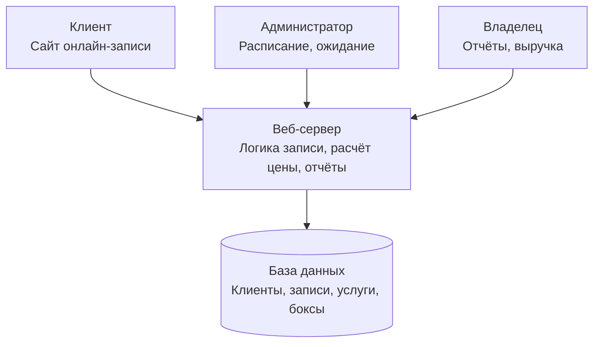
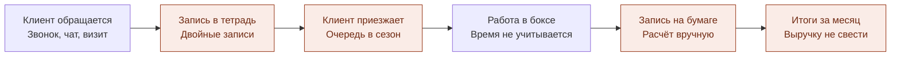
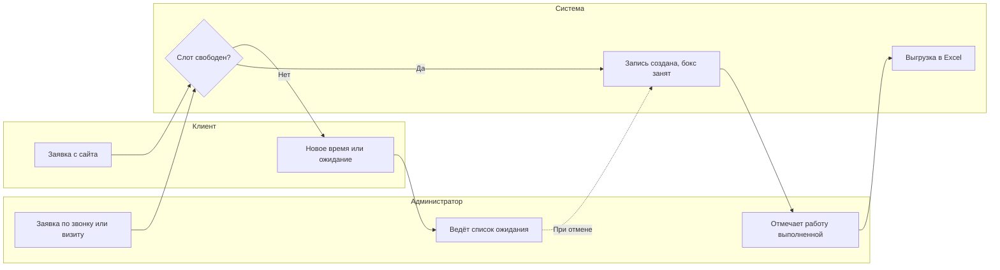
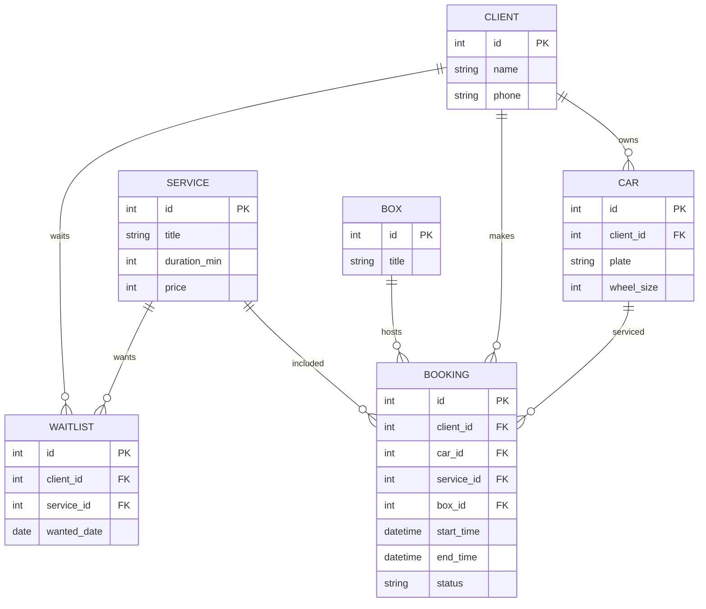

# Схемы проекта: система онлайн-записи для шиномонтажа

## 1. Архитектура

## 2. Процесс «как есть»

Красным отмечены проблемные места процесса.

## 3. Процесс «как будет»

## 4. ER-диаграмма базы данных

